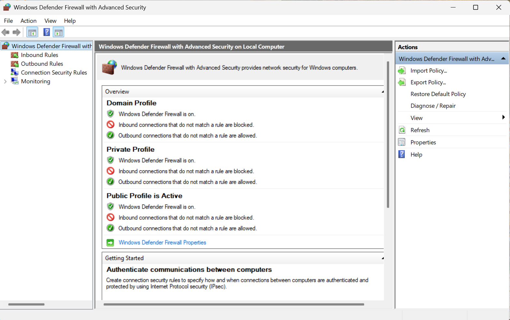
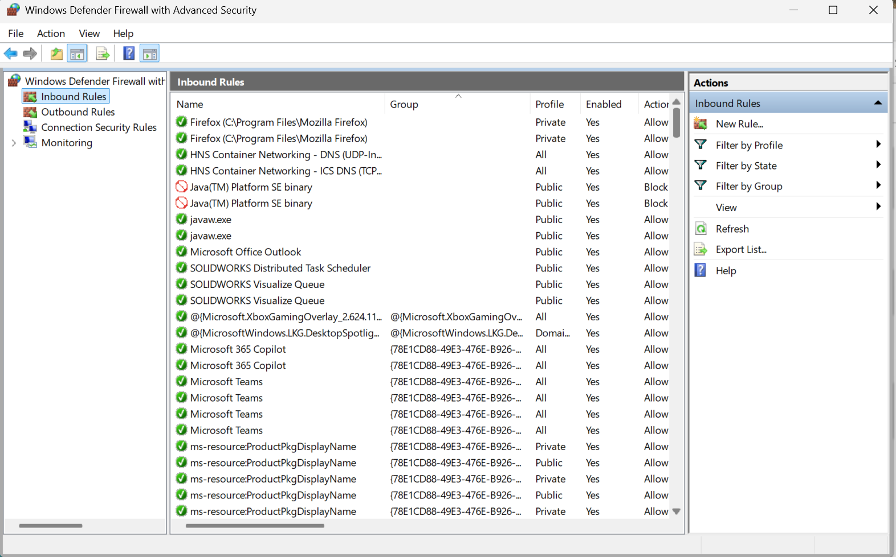
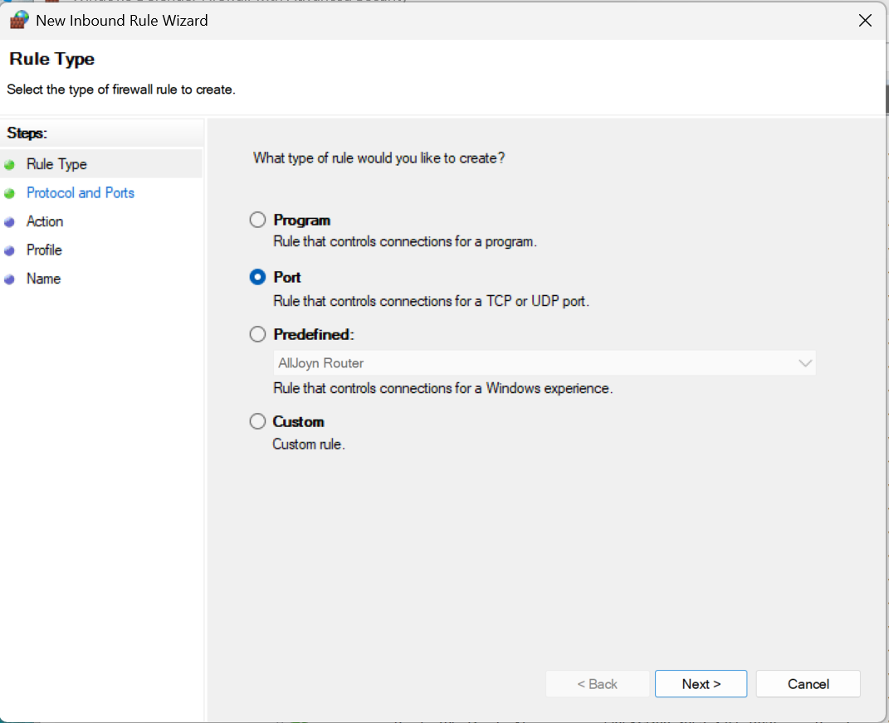
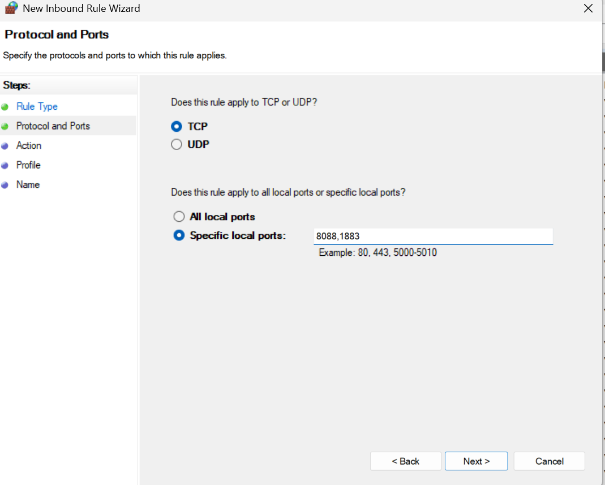
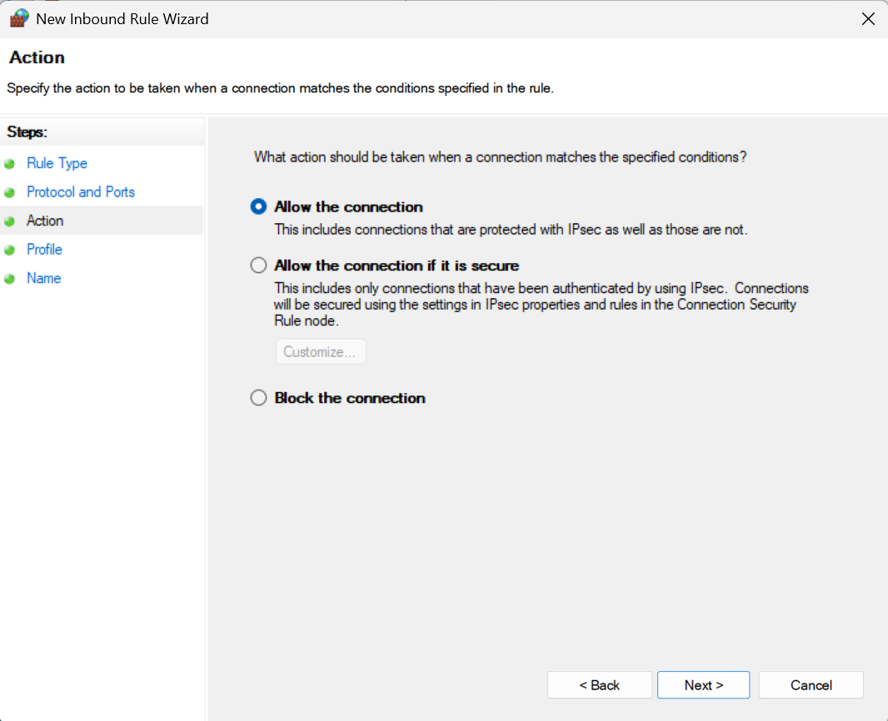

[Back to Main Menu](https://github.com/CCC-Industry4/IIOT-4.0-Project/tree/main)
# Prepping the firewall
---
## Windows firewall
- Press the Windows key and type wf.msc, open up the program titled "Windows defender firewall with advanced security". Once you open it up you should see something like this.

## Inbound Rule
- On the left-hand side click "Inbound Rules" then on the right-hand side click "New Rule..." that is under the "Inbound Rules" action. 

## Rule Type
- In the new rule setup wizard click port as the rule type. 

## Protocol and Ports 
- On the protocol and ports step click TCP for your networking protocol and select allow specific local ports. Type "8088,1883" into the box. 

## Action
- On the action step click "Allow the connection". 

## Misc
- On the profile step keep all boxes checks 
- On the name step, name it something you can remember it by like "ignition".
---

