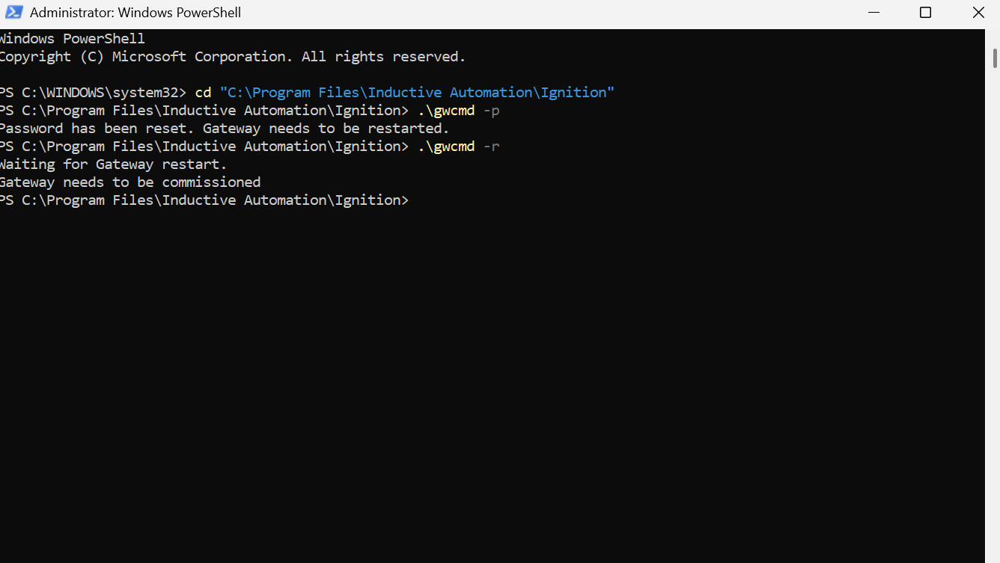
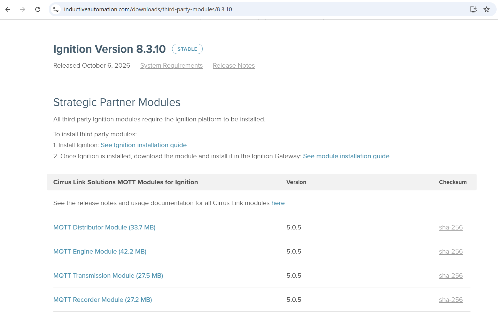
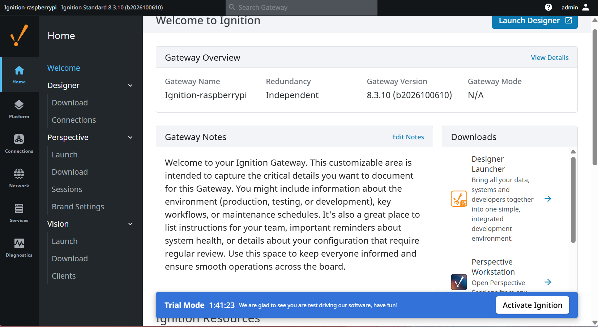
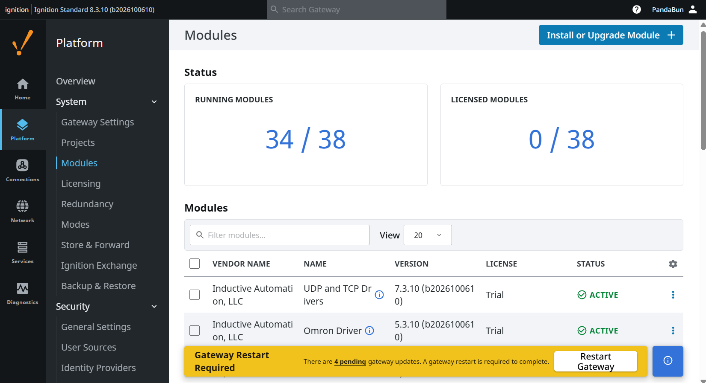

[Back to Main Menu](https://github.com/CCC-Industry4/IIOT-4.0-Project/tree/main)
# Ignition Configuration

# Downloading Ignition and Restoring Gateway on a PC
Downloading ignition on your respective OS can be frustrating for some because when you select a version you want to download it can ask you for a lot of information.
1. The first step is to go to this link and install a version of ignition with the characteristics 8.3.xx, this [link](https://inductiveautomation.com/downloads/ignition/8.3.10) takes you to version 8.3.10
2. Depending on how your PC is set up (e.g, if your computer has installed ignition before or not) ignition might ask you for some information when trying to install it.
   - For the first and last name you can put yours
   - For company name you can put your school's name
   - For email you can put your school email
   - For the phone number if you don't feel comfortable putting your own then you can ask your instructor what to put here
   - Role should be set to Jobseeker/student
   - "Are you an integrator" should be set to no
   - Here is an example of a filled out download form 
3. Now that ignition has been downloaded go to this [link](http://localhost:8088) if it wasn't brought up automatically already and download the .gwbk file in the ignition folder in this repo.
   - On the left hand-side click platform under the system category, then click Backup & Restore. 
   - Once the gateway has been restored it is important to note that the password and username have now been defaulted to their original values.
   - If you wish to change the password and username there is a short process in order to so.
   - First open up PowerShell in administrator mode and type or paste the following commands.
     1.  cd "C:\Program Files\Inductive Automation\Ignition"
     2.   .\gwcmd -p
     3.   .\gwcmd -r
   
   - After the password has been reset go to this [link](http://localhost:8088), and you should see a page like this now 
    - Fill in the pertinent information and click finish setup then wait a small amount of time and you are done.

## Module Configuration
To install the MQTT modules for Ignition, you must do the following (see this video for more information): [Video Link](https://youtu.be/AB4knX_4n5c) or you can just follow this written guide.
1. Use this [link](https://inductiveautomation.com/downloads/third-party-modules/8.3.4) and download the ones that start with MQTT(Distributor, Engine, Transmission, Recorder). 
2.  Type http://localhost:8088 into a web browser or click this [link](http://localhost:8088). 
3.  Log in with the default ignition credentials unless they have been changed (username = admin, password = password, if you have not reset your password after restoring your gateway from the .gwbk file then these are the default credentials).
4. On the left-hand side of your screen click the tab that says "Platform", click system, and finally click modules.
5. In the upper right-hand corner click the blue button that says "Install or upgrade module".
6. Click choose file and install all the .modl files that start with MQTT that you just downloaded. After installing the modules you should see a yellow box that you can expand at the bottom of your screen, click it and then click restart gateway. If for some reason you do not see the yellow box you can use these commands while in an active administrator PowerShell session.
   1.  cd "C:\Program Files\ Inductive Automation\Ignition"
     2.   .\gwcmd -r

# Ignition Licenses for Education
Ignition allows individuals to use full ignition on a two-hour resettable trial basis indefinitely for non-commercial use.  Alternatively Ignition Maker Edition, a streamed down version, may be used for personal use without the need for resetting, but must be connected to the internet.  Inductive Automation partners with qualifying educational institutions to provide free Ignition licenses to students anywhere in the world! Apply here: [https://inductiveautomation.com/educational-engagement](https://inductiveautomation.com/educational-engagement)

---
