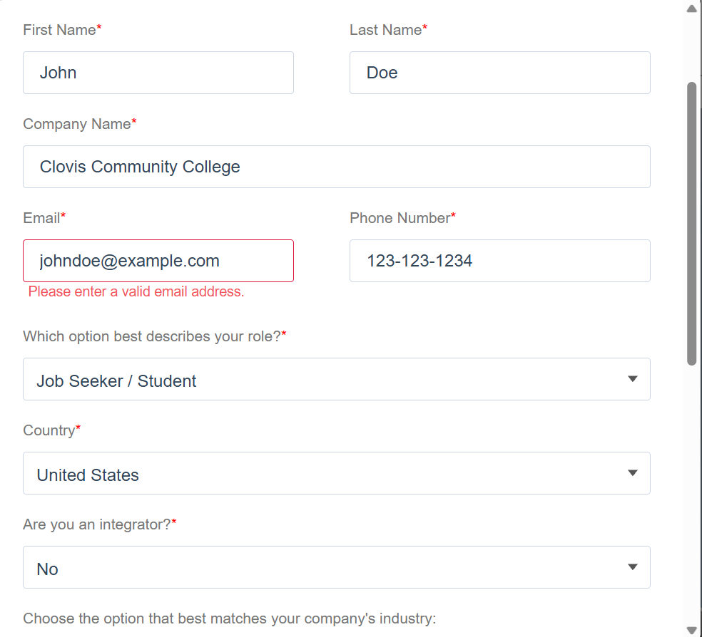
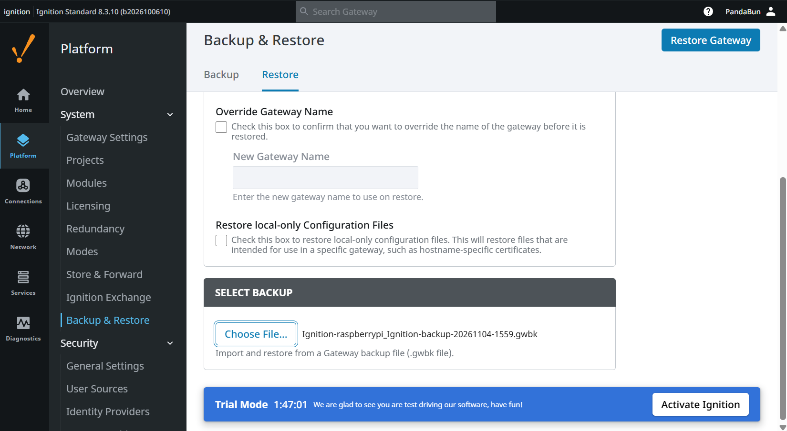
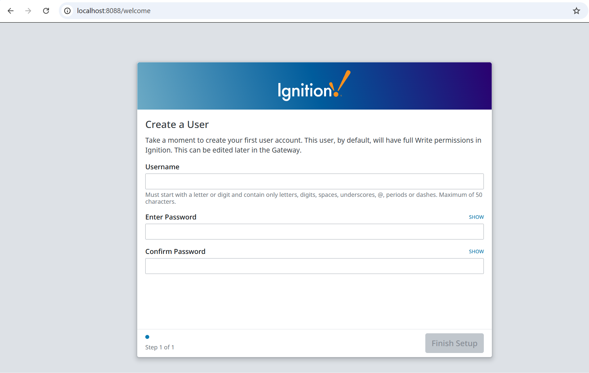

[Back to Main Menu](https://github.com/CCC-Industry4/IIOT-4.0-Project/tree/main)
# Ignition Configuration

# Downloading Ignition and Restoring Gateway on a PC

1. Go to this link and install a version of ignition with the characteristics 8.3.xx, this [link](https://inductiveautomation.com/downloads/ignition/8.3.10) takes you to version 8.3.10.
2. Depending on how your PC is set up (e.g, if your computer has installed ignition before or not), ignition might ask you for some information when trying to install it.
   - Put your first and last name.
   - Company Name - use the name of your school.
   - Use your school email.
   - If uncomfortable with using your own phone number, ask the instructor what to put here.
   - Role should be set to Job Seeker/ Student.
   - Select “No” for the question “Are you an integrator”.
   - Here is an example:
3. Now that ignition has been downloaded go to this [link](http://localhost:8088) and sign in with the default username and password (username = admin, password = password), after signing in download the .gwbk file [here](https://github.com/CCC-Industry4/IIOT-4.0-Project/tree/22c610ca6eb637980d1a4cea901977109b490b88/PC%20Guide/ignition).
   - On the left hand-side click platform under the system category, then click Backup & Restore. 
   - Once the gateway has been restored it is important to note that the password and username have now been defaulted to their original values.
   - If you want to change the password and username, follow these steps.
   - First open up PowerShell in administrator mode and type or paste the following commands.
     1.  cd "C:\Program Files\Inductive Automation\Ignition"
     2.   .\gwcmd -p
     3.   .\gwcmd -r
   
   - After the password has been reset go to this [link](http://localhost:8088), and you should see a page like this now. 
    - Fill in the pertinent information, click "Finish Setup" then wait a short amount of time for it to finish.

## Module Configuration
To install the MQTT modules for Ignition, follow this guide (see this video for more information: [Video Link](https://youtu.be/AB4knX_4n5c))

1. Use this [link](https://inductiveautomation.com/downloads/third-party-modules/8.3.4) and download the ones that start with MQTT(Distributor, Engine, Transmission, Recorder). 
2.  Type http://localhost:8088 into a web browser or click this [link](http://localhost:8088). 
3.  Log in with the default ignition credentials unless they have been changed (username = admin, password = password, if you have not reset your password after restoring your gateway from the .gwbk file then these are the default credentials still).
4. On the left-hand side of your screen click the tab that says "Platform", click system, and finally click modules.
5. In the upper right-hand corner click the blue button that says "Install or upgrade module".
6. Click choose file and install all the .modl files that start with MQTT that you just downloaded. After installing the modules you should see a yellow box. Click the error triangle symbol on the right most side. This will change the box and display a “Restart Gateway” button. Press it. If you have any issues you can use these commands instead while in an active administrator PowerShell session.
   1.  cd "C:\Program Files\ Inductive Automation\Ignition"
     2.   .\gwcmd -r

# Ignition Licenses for Education
Ignition allows individuals to use full ignition on a two-hour resettable trial basis indefinitely for non-commercial use.  Alternatively Ignition Maker Edition, a streamed down version, may be used for personal use without the need for resetting, but must be connected to the internet.  Inductive Automation partners with qualifying educational institutions to provide free Ignition licenses to students anywhere in the world! Apply here: [https://inductiveautomation.com/educational-engagement](https://inductiveautomation.com/educational-engagement)

---
