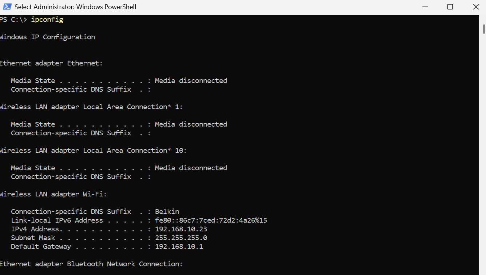
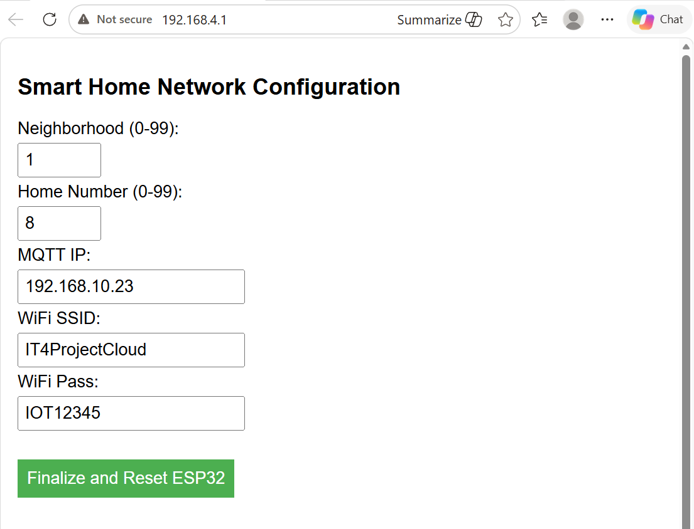
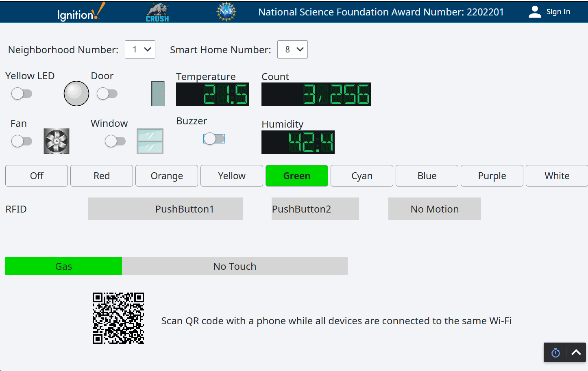

[Back to Main Menu](https://github.com/CCC-Industry4/IIOT-4.0-Project/tree/main)

# Configure Smart Home
---
1. Open up an instance of PowerShell on your Windows machine and type in the command: ipconfig. Locate your IPv4 address and save it for later. In the example image provided below the IPv4 address is 192.168.10.23. 
2. Plug in and power up a Smart Home (make sure it has access to sufficient power, problems can occur when the house doesn't have enough power).
3. Set the home into config mode, if you are unsure how to do this you can reference the PowerPoint guide or continue with this written one.
     1. Look inside the smart home and locate the reset button.
     2. press the reset button and pay attention to the on-screen instructions.
     3. it should say press both buttons to enter config mode, if you missed the prompt you can go back to step 2 or follow the new on-screen instructions.
4. Now that the smart home is in config mode it has become a Wi-Fi access point that you can connect to with a Wi-Fi supported device such as your phone or your pc. While connected to Config_ESP32, navigate to the IP listed on the LCD screen using a web browser.
      

  -  Ask your instructor for the neighborhood and home number:
      -  Neighborhood number(s) -**should** be the same for the whole class.
      -  Home numbers **must** be unique for each home in the same neighborhood.
      -  MQTT IP will be the IPv4 number that you should have from earlier
      -  Wi-Fi SSID and Password will be any Wi-Fi you can connect to, but you **must** be connected to the same Wi-Fi as your pc. You also must be connected to this same Wi-Fi if you want to interact with ignition on a different device othet than your PC. 
      -  You can add rules or key fobs now if you wish to do so.
	  - **Click Finalize and Reset ESP32.** When you are ready.

5. **Verify** that your Smart Home is working; while on ignition click on home and under the perspective category click launch then click I4Project_Demo. Here you can play around with different smart home functions and make sure they are working properly.

6. You can view "Demo" page on other devices other than your PC but make sure **all** devices inlcuding the smart home are connected to the same Wi-Fi. 
